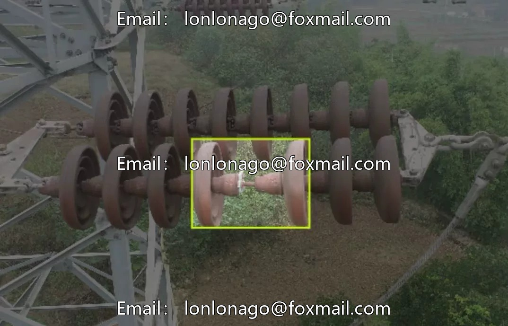
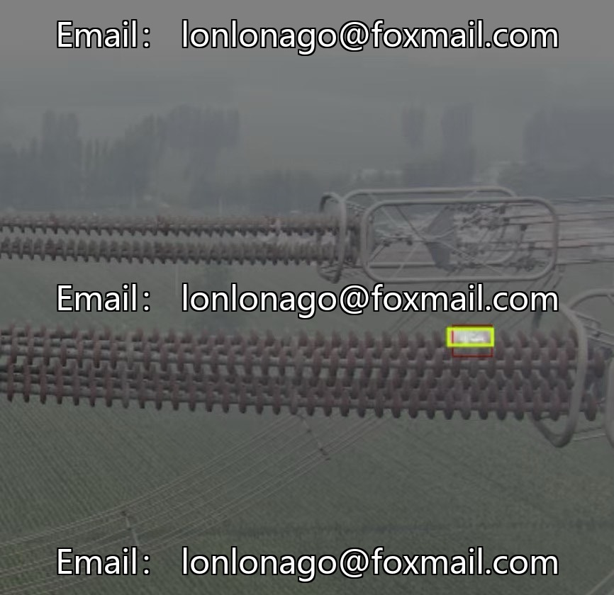
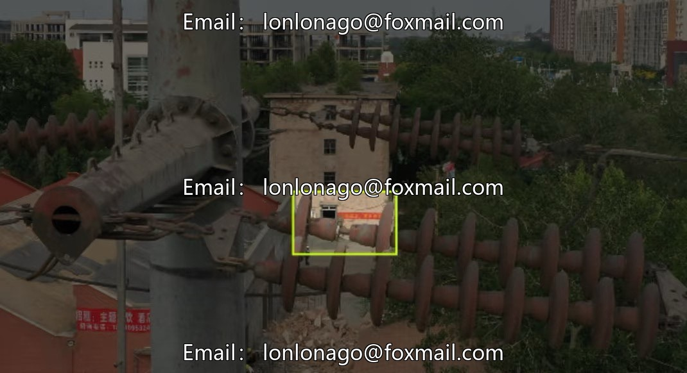
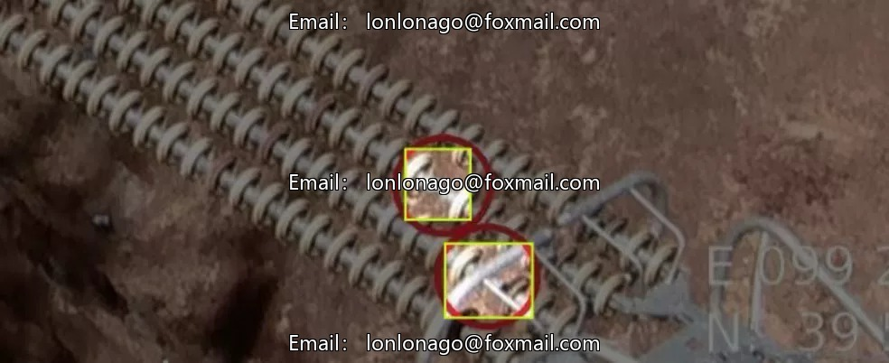

# Insulator Defect/Self-Explosion Detection Data Set, Drone Viewpoint, Including 790 Images

## Body

Insulator Defect/Self-Explosion Detection Dataset, Drone Viewpoint, Including 790 Images, 2 Types of Labels: Defect, Self-Explosion. The annotation format is YOLO, supports training with models like Yolov5/v8/v11, suitable for scenarios such as power drone inspection, intelligent monitoring of transmission lines, health monitoring of insulators, quality classification, intelligent inspection, etc.

The dataset images and annotations are one-to-one corresponding, which can be directly used for model training and convenient for integrated deployment.

Virtual materials, once sold, are non-refundable.
Interested friends, click "I want" to proceed.

## Images

## Payment

Here is a pay link on Stripe ( https://buy.stripe.com/3cs8yP7sY87d0vu9AB ). Please contact me lonlonago@foxmail.com after funding $89, and I will send you a complete data files , thank you!

